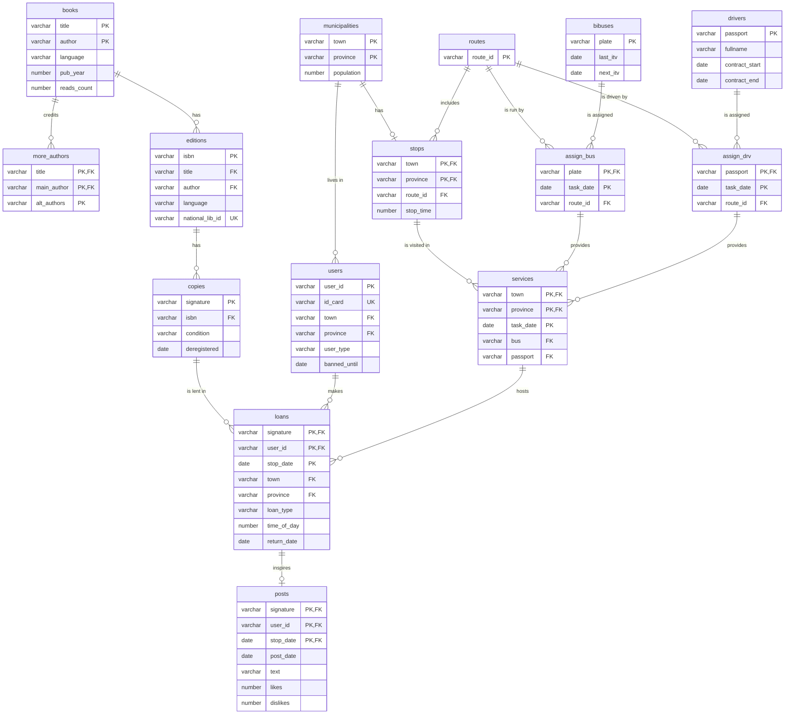

# Bookmobile Database

Oracle SQL / PL/SQL database for a mobile library service: a bus visits towns on a fixed schedule, and users can reserve, borrow and return books and write short posts about what they read. The project covers the data model, the business rules (PL/SQL package and triggers), per-user views, sample data, example queries and tests.

It started as a university database course assignment and was rewritten into a self-contained repository.

[Versión en español](README.es.md)

## What it shows

- Relational design with composite keys, check constraints and referential integrity (15 tables).
- A PL/SQL package that enforces the lending rules: borrowing limit, bans, availability, reservations that turn into loans, and late-return penalties.
- Triggers for business rules that constraints cannot express.
- Views with `INSTEAD OF` triggers that give each user access to their own data only.
- Analytical queries with CTEs, anti-joins and aggregation.
- Self-checking test scripts written in PL/SQL.

## Data model



A **service** is one visit of a bus and its driver to a stop on a given day. A **loan** row represents either a loan (`L`) or a reservation (`R`) and is tied to a service, so nothing can be lent in a town on a day the bus does not go there.

## Repository layout

```
sql/
  install.sql          runs everything below in order
  00_reset.sql         drops the project's objects (safe on an empty schema)
  01_schema.sql        tables, constraints and indexes
  02_package.sql       bookmobile_pkg: reserve, loan and return procedures
  03_triggers.sql      table triggers
  04_views.sql         per-user views and their INSTEAD OF triggers
  05_sample_data.sql   fictional sample data
  06_queries.sql       example queries
tests/
  test_package.sql
  test_triggers.sql
  test_views.sql
```

## Getting started

You need Oracle Database 12c or later and a user that can create tables, views, packages and triggers. A quick way to get one is the free Oracle container image:

```bash
docker run -d --name oracle -p 1521:1521 \
  -e ORACLE_PASSWORD=change_me \
  -e APP_USER=bookmobile -e APP_USER_PASSWORD=change_me \
  gvenzl/oracle-free:slim
```

Install everything from the `sql` directory with SQL*Plus or SQLcl:

```bash
cd sql
sqlplus bookmobile/change_me@//localhost:1521/FREEPDB1 @install.sql
```

Then run the example queries (`@06_queries.sql`) or the tests.

## Business rules

| Rule | Where |
|------|-------|
| A user can have at most 5 open loans and reservations | `bookmobile_pkg` |
| Banned users cannot borrow or reserve | `bookmobile_pkg` |
| Loans and reservations happen on a day the bus visits the user's town | `bookmobile_pkg` and foreign key to `services` |
| Damaged, deregistered, lent or reserved copies are not available | `bookmobile_pkg` |
| A reservation for a day becomes a loan when the user collects the copy | `bookmobile_pkg.loan_copy` |
| Loans last 14 days; returning late bans the user for as many days as the delay | `bookmobile_pkg.return_copy` |
| Institutional users cannot publish posts | `trg_posts_no_institutions` |
| Marking a copy as damaged records its deregistration date | `trg_copies_deregister` |
| Each loan increases the read counter of its book | `trg_loans_count_reads` |

Usage example:

```sql
-- Reserve a copy for an upcoming visit, then collect it on the day
EXEC bookmobile_pkg.reserve_copy('CP002', 'U000000003', DATE '2027-01-12');
EXEC bookmobile_pkg.loan_copy('CP002', 'U000000003', DATE '2027-01-12');

-- Return it
EXEC bookmobile_pkg.return_copy('CP002');
```

The procedures never commit, so the caller decides when to `COMMIT` or `ROLLBACK`. Errors are raised with codes `-20001` to `-20011`, documented at the top of `02_package.sql`.

### Per-user views

`my_data`, `my_loans` and `my_reservations` show only the rows of the user whose id is stored in the session client identifier:

```sql
EXEC DBMS_SESSION.SET_IDENTIFIER('U000000003');

SELECT * FROM my_loans;
INSERT INTO my_reservations (signature, stop_date) VALUES ('CP002', DATE '2027-01-12');
UPDATE my_loans SET post_text = 'Great read' WHERE signature = 'CP008';
```

## Tests

The scripts need the project to be installed. Each one prints `[PASS]` or `[FAIL]` per check and rolls back its changes, so the sample data stays intact.

```bash
cd tests
sqlplus bookmobile/change_me@//localhost:1521/FREEPDB1 @test_package.sql
sqlplus bookmobile/change_me@//localhost:1521/FREEPDB1 @test_triggers.sql
sqlplus bookmobile/change_me@//localhost:1521/FREEPDB1 @test_views.sql
```

## Notes

- All sample data (towns, people, e-mail addresses, phone numbers, ISBNs) is fictional.
- Scripts are ASCII only to avoid character-set problems in SQL*Plus.
